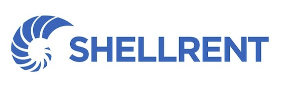

# Intesa Sanpaolo Open Banking – PHP SDK

[](https://packagist.org/packages/shellrent/intesasanpaolo-openbanking-php)
[](LICENSE.md)

SDK PHP **non ufficiale** per le API [SmartHub](https://smarthub.intesasanpaolo.com/it/homepage/documenti-sviluppo.html) di Intesa Sanpaolo, dedicate a conti correnti e pagamenti delle aziende.

> [!WARNING]
> **Branch `3.x`: riscrittura in corso.** Questo branch contiene la futura versione 3.0.0 e le sue API non sono ancora stabili. Per la versione stabile usa la 2.x (`composer require shellrent/intesasanpaolo-openbanking-php:^2.1`, branch `main`). Avanzamento dei lavori: [docs/v3/ROADMAP.md](docs/v3/ROADMAP.md).

## Funzionalità

| Area | API | 2.x | 3.0 |
|---|---|:---:|:---:|
| Conti | saldo, movimenti di fine giornata e intraday | ✅ | in sviluppo |
| SCT Instant | simulazione, esecuzione, stato, lista | ✅ | in sviluppo |
| SCT (bonifico ordinario) | simulazione, esecuzione, stato, lista, revoca | ✅ | in sviluppo |
| Strumenti | verifica IBAN (sintattica, esistenza, congruenza CF/P.IVA), raggiungibilità SCT Instant | — | pianificata |

Il dettaglio per endpoint è in [docs/api-coverage.md](docs/api-coverage.md).

## Requisiti

- PHP 8.3 o superiore (la 2.x richiede PHP 8.0), con estensione `json`.
- Guzzle 7.15.2+ oppure Guzzle 8.0.1+.

  > [!NOTE]
  > Se il tuo PHP carica l'estensione PECL `psr` (frequente negli ambienti Phalcon), usa Guzzle 7: le interfacce dell'estensione sono incompatibili con Guzzle 8 (psr7 3.x).
- Un'app registrata su SmartHub con le API necessarie attive, e le relative credenziali (client ID e client secret).
- Il certificato di mutua autenticazione (mTLS), che si scarica dalla sezione *Certificates Management* dell'area riservata SmartHub.

## Installazione

```bash
composer require shellrent/intesasanpaolo-openbanking-php
```

## Ambienti e autenticazione

- **Sandbox e Live**: le API sono identiche, ma la sandbox restituisce dati fittizi. Si sviluppa e si prova in sandbox, poi si passa a Live.
- **OAuth2**: l'SDK ottiene e rinnova da sé il token (flusso *client credentials*).
- **Mutua autenticazione**: le API richiedono un certificato client, in formato PEM con chiave privata oppure PKCS#12.
  - Lo stesso certificato vale per Live e sandbox.
  - Dura un anno, e se ne possono avere al massimo due attivi: genera e installa il nuovo prima che scada il vecchio.

## Verification of Payee (VoP)

Dal 2025 la simulazione di un bonifico (SCT e SCT Instant) restituisce anche l'esito della verifica del beneficiario, cioè la corrispondenza tra IBAN e nome. **Eseguire il bonifico equivale ad accettare quell'esito**, quindi controllalo prima di procedere. La 3.0 lo rende disponibile direttamente nel risultato della simulazione.

## Utilizzo

Gli esempi d'uso della 3.0 verranno aggiunti man mano che le API vengono riscritte. Per la 2.x fa fede il codice dei metodi pubblici di `IntesaSanPaoloClient`.

## Sviluppo

```bash
composer install
composer ci      # validate, formattazione (Pint), analisi statica (PHPStan), test (PHPUnit)
```

Le regole del progetto (convenzioni, quirk delle API, uso delle spec) sono in [AGENTS.md](AGENTS.md) e nella cartella [docs](docs/README.md). Per contribuire leggi [CONTRIBUTING.md](CONTRIBUTING.md).

## Sicurezza

Per segnalare una vulnerabilità **non aprire una issue pubblica**: segui le indicazioni di [SECURITY.md](SECURITY.md).

## Note legali

Questo progetto non è affiliato a Intesa Sanpaolo né approvato da Intesa Sanpaolo. I nomi e i marchi citati appartengono ai rispettivi proprietari.

## Sponsor

<!--special start-->
<p>
  <a href="https://www.shellrent.com" target="_blank">
      
  </a>
</p>
<!--special end-->

## Credits

- [Tobia Zanarella](https://github.com/shellrent)
- [Armando Caprio](https://github.com/shellrent)
- [Shellrent Srl](https://www.shellrent.com)
- [Tutti i contributori](../../contributors)

## Licenza

MIT. Vedi [LICENSE.md](LICENSE.md).
